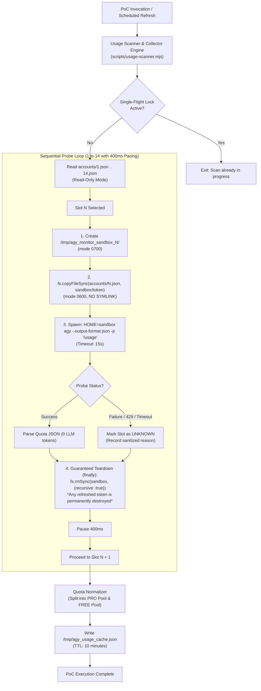

# AGY USAGE MONITOR — PHASE 2: TECHNICAL DESIGN (REVISED)

**Target Project:** `/home/ubuntu/agy-telegram`  
**Repository:** `https://github.com/azerodesign/agy-telegram`  
**Design Status:** **APPROVED DESIGN — SCOPED TO PHASE 2 PoC ONLY**  
**Author:** Antigravity Engineering Pair Assistant  
**Date:** October 31, 2026  

---

## 1. Executive Summary & Authorization Boundary

This revised technical design incorporates all feedback and mandatory safety restrictions from the technical review.

### Authorization Boundary:
* **Current Scope:** **Phase 2 Proof of Concept (PoC) — Scanner & Collector Engine ONLY.**
* **Deferred to Subsequent Phase:** Telegram UI integration in `bot.mjs`, alerts, callback handlers, and command `/usage` replacements are **NOT** included in this PoC stage.
* **Strict Production Guardrails:**
  * No production credential modification under any circumstance.
  * No service restart (`agy-telegram.service` remains running uninterrupted).
  * No database or configuration migrations.

### Core Safety Commitments & Mandatory Corrections:
1. **Isolated Copy Only (Zero Symlinks):** Every account probe operates in a dedicated temporary sandbox containing an isolated copy of that account's credential.
2. **Absolute Zero Write-Back (No Two-Way Sync):**
   * Any token refreshed by Google OAuth during a sandbox probe remains strictly inside `/tmp/...` and is **permanently discarded** when the sandbox is wiped.
   * **ALL two-way sync, copy-back, and auto-sync mechanisms are completely removed.**
   * Production account files (`accounts/*.json`) and `antigravity-oauth-token` remain 100% immutable and read-only.
3. **No Account State Tampering:**
   * `round_robin_state.json` is never read with write locks or modified.
   * `ag-acc switch`, `ag-acc rotate`, `ag-acc pro`, or any account switching scripts are **forbidden**.
4. **Guaranteed Teardown on All Failure Modes:**
   * Sandboxes are wiped in a `finally` block on success, error, timeout, unhandled rejection, `SIGTERM`, `SIGINT`, and process exit.
5. **Sequential Execution & Error Isolation:**
   * Accounts are queried sequentially ($1 \rightarrow 14$) with a 400ms inter-slot delay.
   * If any account fails (process crash, OAuth refresh failure, network timeout, corrupted token), that slot is recorded as `UNKNOWN` and the scanner proceeds cleanly to the next account.
6. **Zero Token Leakage:**
   * No `access_token`, `refresh_token`, or unmasked emails are ever emitted to stdout, logs, or disk caches.

---

## 2. System Architecture (PoC Scope)



---

## 3. Safe Sandbox Creation, Execution, and Guaranteed Teardown

### 3.1 Ephemeral Path Hierarchy
For slot `N` ($N \in [1..14]$), a dedicated temporary path is constructed:
```javascript
const sandboxRoot = path.join(
  os.tmpdir(),
  `agy_monitor_sandbox_${slot}_${Date.now()}_${crypto.randomBytes(4).toString('hex')}`
);
const dotGemini = path.join(sandboxRoot, '.gemini', 'antigravity-cli');
const sandboxToken = path.join(dotGemini, 'antigravity-oauth-token');
```

### 3.2 Strict Creation & Verification Protocol
1. **Directory Creation:**  
   `fs.mkdirSync(dotGemini, { recursive: true, mode: 0o700 });`
2. **Source Validation:**  
   Verify `/home/ubuntu/.gemini/antigravity-cli/accounts/${slot}.json` is a real regular file and not a symlink.
3. **Byte-Copy (Isolated Sandbox Copy):**  
   `fs.copyFileSync(sourcePath, sandboxToken);`  
   `fs.chmodSync(sandboxToken, 0o600);`
4. **Symlink Prohibition Assertion:**  
   `if (fs.lstatSync(sandboxToken).isSymbolicLink()) throw new Error('Symlink detected; aborting.');`

### 3.3 Comprehensive Teardown Guarantee
A process-wide registry tracks active sandboxes so that **zero orphaned directories or credentials** are left behind under any termination condition:

```javascript
const activeSandboxes = new Set();

function registerSandbox(dir) { activeSandboxes.add(dir); }
function unregisterSandbox(dir) { activeSandboxes.delete(dir); }

function cleanupAllSandboxesSync() {
  for (const dir of activeSandboxes) {
    try {
      if (fs.existsSync(dir)) fs.rmSync(dir, { recursive: true, force: true });
    } catch (_) {}
  }
  activeSandboxes.clear();
}

// Process lifecycle hooks
process.on('exit', cleanupAllSandboxesSync);
process.on('SIGINT', () => { cleanupAllSandboxesSync(); process.exit(130); });
process.on('SIGTERM', () => { cleanupAllSandboxesSync(); process.exit(143); });
process.on('uncaughtException', (err) => {
  cleanupAllSandboxesSync();
  console.error('[UsageScanner Fatal Error]', err.message);
  process.exit(1);
});
```

* **Per-Slot Scoped Teardown:**
```javascript
async function withIsolatedSandbox(slot, fn) {
  const sandbox = createSandbox(slot);
  registerSandbox(sandbox.root);
  try {
    return await fn(sandbox);
  } finally {
    try {
      if (fs.existsSync(sandbox.root)) {
        fs.rmSync(sandbox.root, { recursive: true, force: true });
      }
    } finally {
      unregisterSandbox(sandbox.root);
    }
  }
}
```

---

## 4. No Write-Back Policy (Refreshed Token Discard)

### 4.1 Strict Discard Rule
* **The Reality of Idle Tokens:** Google OAuth2 access tokens expire after 1 hour. Inactive slots will prompt `agy` to trigger an OAuth token refresh.
* **The Containment:** Because `HOME` is redirected to `SANDBOX_ROOT`, `agy` writes the newly refreshed token only to:
  $$\text{SANDBOX\_ROOT}/.gemini/antigravity-cli/antigravity-oauth-token$$
* **The Discard:** As soon as stdout is parsed, `fs.rmSync(sandbox.root)` is executed. The refreshed token is permanently deleted.
* **Production Invariance:**
  * No file in `/home/ubuntu/.gemini/antigravity-cli/accounts/` is ever touched or opened in write mode (`'w'`, `'a'`, `w+`).
  * If the OAuth refresh fails in the sandbox (e.g. revoked Google account or `invalid_grant`), the error is trapped, slot status is set to `UNKNOWN`, and the loop immediately advances to the next slot.

---

## 5. Model Groups Parser & Quota Normalization

### 5.1 Quota Extraction
`agy --output-format json -p "/usage"` returns the `command.data.groups` array. The parser extracts metrics for the three required groups:

1. **Gemini Models:**
   * Bucket `gemini-5h`: `pct5h = Math.round(remaining_fraction * 100)`, `reset5hUtc = reset_time`
   * Bucket `gemini-weekly`: `pctWeekly = Math.round(remaining_fraction * 100)`, `resetWeeklyUtc = reset_time`
2. **Claude and GPT models:**
   * Bucket `3p-5h`: `pct5h = Math.round(remaining_fraction * 100)`, `reset5hUtc = reset_time`
   * Bucket `3p-weekly`: `pctWeekly = Math.round(remaining_fraction * 100)`, `resetWeeklyUtc = reset_time`
3. **Gemini 4 Argon:**
   * Bucket `gemini-argon-wtu-weekly`: `pctWeekly = Math.round(remaining_fraction * 100)`, `resetWeeklyUtc = reset_time`

### 5.2 Structured Dataset (Two Pools Separation)
To fulfill the requirement of two distinct tables, the output schema separates PRO and FREE pools:

```json
{
  "updated_at_utc": "2026-10-31T10:15:00Z",
  "scan_duration_seconds": 26.4,
  "pools": {
    "pro": [
      {
        "slot": "1",
        "plan": "PRO",
        "email": "zer***@gmail.com",
        "status": "OK",
        "gemini": { "pct_5h": 72, "reset_5h": "18:57 CST", "pct_weekly": 41, "reset_weekly": "Tomorrow 14:51" },
        "claude_gpt": { "pct_5h": 100, "reset_5h": "22:30 CST", "pct_weekly": 92, "reset_weekly": "Nov 05 16:24" },
        "argon": { "pct_weekly": 97, "reset_weekly": "Nov 04 23:41" }
      }
    ],
    "free": [
      {
        "slot": "2",
        "plan": "FREE",
        "email": "use***@gmail.com",
        "status": "OK",
        "gemini": { "pct_5h": 100, "reset_5h": "21:00 CST", "pct_weekly": 85, "reset_weekly": "Nov 03 10:00" },
        "claude_gpt": { "pct_5h": 100, "reset_5h": null, "pct_weekly": null, "reset_weekly": null },
        "argon": { "pct_weekly": null, "reset_weekly": null }
      }
    ]
  }
}
```

* **Slot Partitioning:**
  * **PRO Pool (7 Accounts):** Slots `1`, `5`, `6`, `7`, `9`, `10`, `12`
  * **FREE Pool (7 Accounts):** Slots `2`, `3`, `4`, `8`, `11`, `13`, `14`

---

## 6. Execution Control & Error Management

1. **Timeout Enforcement:**  
   Child processes are allocated a maximum of 15 seconds. If the process does not exit, `proc.kill('SIGKILL')` is dispatched, sandbox is wiped, and slot status is marked `UNKNOWN: TIMEOUT`.
2. **HTTP 429 Handling:**  
   If an account encounters rate limiting during metadata retrieval, the scanner waits for 15 seconds before probing the next slot. The active production account is **never rotated**.
3. **Secret Redaction:**  
   Raw outputs are parsed strictly for `groups` and `buckets`. No raw token strings are retained in the resulting snapshot or printed to stdout.

---

## 7. Files to Be Created (PoC Scope)

In this Phase 2 PoC, **NO PRODUCTION APPLICATION FILES WILL BE MODIFIED**. Specifically:
* [`/home/ubuntu/agy-telegram/bot.mjs`](file:///home/ubuntu/agy-telegram/bot.mjs) **WILL NOT BE TOUCHED**.
* Service configurations **WILL NOT BE TOUCHED**.

### New Files to Create:
1. [`/home/ubuntu/agy-telegram/src/usage/scanner.mjs`](file:///home/ubuntu/agy-telegram/src/usage/scanner.mjs):  
   Standalone, self-contained Usage Scanner & Collector Engine implementing sandbox copy, execution, normalization, and teardown.
2. [`/home/ubuntu/agy-telegram/scripts/test-usage-poc.mjs`](file:///home/ubuntu/agy-telegram/scripts/test-usage-poc.mjs):  
   Dedicated verification test harness executing pre/post checksum checks, probing test slots, and asserting zero mutation on production files.

---

## 8. Zero Production Mutation Verification Mechanism

The test script will verify zero mutation using the following deterministic proof:

```
[Phase A: Pre-Scan Checksum Baseline]
  Calculate SHA-256 for:
    - /home/ubuntu/.gemini/antigravity-cli/accounts/*.json (14 files)
    - /home/ubuntu/.gemini/antigravity-cli/antigravity-oauth-token
    - /home/ubuntu/.gemini/antigravity-cli/accounts/round_robin_state.json
  Store hashes in Memory Array A.

[Phase B: Execute Sandboxed Probe]
  Run scanner on designated slots.

[Phase C: Post-Scan Checksum Assertion]
  Calculate SHA-256 for identical file paths into Memory Array B.
  Assert: Array A == Array B (Bit-for-bit exact match, 0 modifications).

[Phase D: Production Daemon Integrity Check]
  Verify agy-telegram systemd PID has not changed.
  Verify /tmp contains zero remaining agy_monitor_sandbox_* folders.
```

---

## 9. Next Step & Request for Explicit Authorization

The technical design is finalized, strictly scoped, and incorporates all safety requirements.

**Awaiting your explicit review and approval before creating the PoC files:**
* [`/home/ubuntu/agy-telegram/src/usage/scanner.mjs`](file:///home/ubuntu/agy-telegram/src/usage/scanner.mjs)
* [`/home/ubuntu/agy-telegram/scripts/test-usage-poc.mjs`](file:///home/ubuntu/agy-telegram/scripts/test-usage-poc.mjs)
